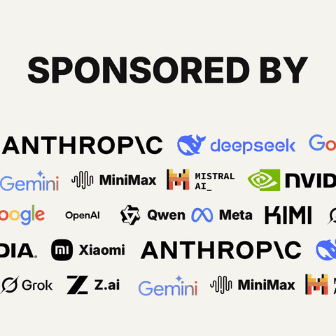

<h1 align="center">sponsored-by</h1>

<p align="center">Type a line, get a card where a fake sponsor scrolls across it.<br>
Runs entirely in your browser — no server, no upload, no account.<br>
<b><a href="https://zyphraxns.github.io/sponsored-by-meme-generator/">Try it live →</a></b></p>

<p align="center">
  <a href="https://zyphraxns.github.io/sponsored-by-meme-generator/">
    
  </a>
</p>

<p align="center">
  <a href="https://github.com/zyphraxns/sponsored-by-meme-generator/actions/workflows/ci.yml"></a>
  <a href="LICENSE"></a>
  <a href="https://www.typescriptlang.org/"></a>
  <br>
  <sub><a href="#quick-start">Quick start</a> · <a href="#export-formats">Export formats</a> · <a href="#how-it-works">How it works</a> · <b>English</b> | <a href="README.zh-CN.md">简体中文</a></sub>
</p>

> [!WARNING]
> **Parody — not affiliated with anyone.** Nothing here implies sponsorship or endorsement, and no brand has endorsed this project. The default content is emoji. You can also drop in real brand marks sourced from [simple-icons](https://simpleicons.org) — those marks stay the trademarks of their owners, and how you use them is your responsibility. If you are a brand and want something removed, open an issue and it will be handled.

---

## What it is

Meme cards like *"SPONSORED BY"* with logos scrolling underneath are everywhere, but making one usually means opening a video editor. This tool does one thing well: render that card in your browser, exactly, and export it in a format that loops wherever you post it.

The interesting part is not the meme — it's that **the same rendering function produces the preview and all four export formats**. There is one source of truth for what the card looks like, so a preview that looks right cannot export wrong.

## Features

- **One renderer, four exports** — `scene(state, t) → SVG` drives live preview, PNG, SVG, GIF and MP4. No separate "export renderer" to drift out of sync.
- **Exporters load on demand** — the first screen ships the editor only; PNG, GIF and SVG are fetched when you click (and prefetched when the browser is idle), MP4 and mediabunny only when you press it. The current entry plus its preloaded chunks are ~33 KB gzip.
- **Seamless looping** — ticker math guarantees the layout at `t = loop` is identical to `t = 0`, so the loop point does not jump.
- **Self-hosted fonts, on demand** — Latin text uses a bundled Inter slice; Chinese uses 97 `unicode-range` slices of Noto Sans SC, fetched and embedded only for the characters actually on screen. Exported PNGs/GIFs look the same on a machine that has never installed the font.
- **Templates are data** — a layout is one JSON file; tonal variants are RFC 6902 JSON Patches applied to the same file. Adding a layout means adding a JSON file, not touching the renderer.
- **Text layers follow the layout** — `sponsored-by` has a title and subtitle; `made-by-gang` has a title and a `@handle` line; `no-sponsors` has only a title. The toolbar generates one field per real text layer, so a single-layer layout never grows an empty extra box, and drafts / share links save copy per layer id.
- **Platform presets** — pick where you are posting: the preset applies a recommended ratio, highlights the export format it recommends, and shows a size estimate against that platform's limit *before* you export.
- **Themes and colour control** — seven one-click themes (Ivory, Paper, Sand, Ink, Cobalt, Forest, Sunset), plus background / foreground / accent pickers. Accent draws the underline beneath the headline; `Mono logos` renders every mark in the foreground colour.
- **Transparent static exports** — a `Transparent PNG/SVG` switch removes the background rectangle and previews the result over a checkerboard. GIF and MP4 always keep a solid background, since that is the only path they support. The switch travels in drafts and share links.
- **Real brand logotypes** — 3000+ single-colour marks from simple-icons plus 153 official wordmarks from SVGL, picked by background luminance so a dark card gets the light-on-dark variant. You can also upload your own SVG or bitmap.
- **Share link and one-click random** — the whole selection fits in the URL hash, so a card can be shared or bookmarked; the randomiser rewrites layout, palette, icons and copy, and undo puts it all back.
- **Undo and redo** — `Cmd/Ctrl+Z` / `Cmd/Ctrl+Shift+Z` (or `Ctrl+Y`), matching toolbar buttons, and up to 50 steps. Dragging a slider or typing into a text field coalesces into one undo step.
- **Any text layer is the editor** — click inside the title, subtitle or handle box to edit it in place, press `Enter` for a hard line break, and finish with `Cmd/Ctrl+Enter` or `Esc`. The toolbar has one textarea per layer, so line breaks survive either way.
- **Preview control** — pause the loop, scrub the timeline to any frame, and `Export PNG` writes exactly the frame on screen.
- **Your work survives a reload** — the current selection (including uploaded logos, up to the local storage limit) is kept in local storage. A share link loads first, but the first edit takes over and a refresh keeps your changes.
- **Share the result** — after exporting a PNG, `Share card` uses the system share sheet on mobile, copies the image to the clipboard on desktop, and falls back to a download when neither is available.
- **Findable files** — exports are named `<title>-<YYYY-MM-DD>-<width>x<height>.<ext>`; with the GitHub preset, exporting a GIF also shows a copy-ready `` snippet for your README.
- **Reorder icons** — drag a selected chip by its handle or move it with the arrow keys; the panel also keeps a `Recently used` row.
- **Bilingual UI** (English / 简体中文) with per-locale card text.

## Quick start

Requires Node.js ≥ 20.

```bash
git clone https://github.com/zyphraxns/sponsored-by-meme-generator.git
cd sponsored-by-meme-generator
npm install
npm run dev          # http://localhost:5173
```

Build a static site (deployable to any static host — the output uses relative paths, so a project subpath like GitHub Pages works):

```bash
npm run build        # → dist/
```

## Export formats

Measured on the default layout, 1:1, 4-second loop, in headless Chrome (see `docs/SPEC.md` §9 for the full evidence trail):

| Format | Settings | Result | Notes |
| --- | --- | --- | --- |
| **GIF** | 1080×1080 · 16 fps · 32 colours · Atkinson dithering | 4.0 MB · 67 frames · ~30 s to encode | The format that actually loops everywhere. Palette is sampled from all frames, so there is no flicker between frames. Export can be cancelled mid-run. |
| GIF (WeChat preset) | 720×720 · 12 fps | 1.5 MB · 50 frames | WeChat may silently downgrade animations over ~1–2 MB, so this preset is deliberately small. Transparent background is ignored. |
| GIF (quick) | 720×720 · 12 fps | ~1.5 MB · ~22 s to encode (estimate) | Optional fast path for any platform; the export panel shows the estimate before you start. |
| **MP4** | 1080×1080 · 30 fps · H.264 | 1.2 MB · 120 frames | Encoded via WebCodecs in ~2 s — an order of magnitude faster than the GIF path. Keyframe interval equals the loop length, so a rewind does not stutter. Transparent background is ignored. |
| **PNG** | native size | ~250 KB | Static frame, fonts embedded as data URIs. Optional transparent background; ink coverage is then measured from alpha. |
| **SVG** | native size | ~5 KB | Vector, fonts referenced from a CDN rather than embedded. Optional transparent background. |

Transparent background applies to PNG and SVG only; GIF and MP4 always render an opaque background.

## Platform presets

| Preset | GIF limit | What the preset does |
| --- | --- | --- |
| X / Twitter | 5 MB (app) · 15 MB (web) | Keeps 1080p. Only a GIF post loops forever — an MP4 becomes a video post with a progress bar. |
| Instagram | — | Applies 4:5 and recommends PNG; the feed does not accept animated GIFs. Stories / Reels are 9:16 — switch the ratio for those. |
| TikTok | — | Applies 9:16 and recommends MP4, the native upload format. |
| Reddit | 20 MB | Applies 4:5; GIFs play inline, though Reddit may transcode them to video. |
| GitHub | 10 MB | Keeps 1080p. GIF animates inline in READMEs; video cannot be inlined. |
| Discord | 20 MB | Keeps 1080p. GIF plays inline; MP4 needs a click. |
| WeChat | 2 MB (practical) | Drops to 720×720 / 12 fps. |
| Xiaohongshu | — | MP4 recommended; GIF support is unreliable. |

The recommended export button for the selected platform is marked with a `Recommended` badge. Size estimates come from a model calibrated against real exports at 1, 3, 5, 8 and 12 rows — the estimate lands within a few percent of the measured file, so the "over limit" warning is trustworthy before you spend 30 seconds exporting.

## Keyboard shortcuts

| Shortcut | Action |
| --- | --- |
| `Cmd/Ctrl+Z` | Undo the last edit |
| `Cmd/Ctrl+Shift+Z`, `Ctrl+Y` | Redo |
| `Enter` (in the on-card text editor) | Insert a hard line break |
| `Cmd/Ctrl+Enter`, `Esc` (in the on-card text editor) | Finish editing |
| Arrow keys on a selected-icon chip | Move that icon earlier or later |

Shortcuts are ignored while the focus is in a text field, so the browser's native text undo keeps working there.

## How it works

```
state + t ──► scene() ──► SVG string ──┬──► innerHTML            (live preview, 60 fps)
                                       ├──► canvas.toBlob()      (PNG)
                                       ├──► modern-gif           (GIF, 67 frames)
                                       └──► WebCodecs + mediabunny (MP4, 120 frames)
```

- `src/core/scene.ts` — the only place the card is rendered. Pure function: same input, same string.
- `src/core/ticker.ts` — seamless scroll math (period = items × spacing; rational LCM for multi-speed rows).
- `src/core/presets.ts` — platform thresholds, derived export settings, calibrated size estimation.
- `src/exporters/` — one file per format; all of them consume `scene()` output and are imported on demand rather than at startup.
- `src/templates/*.json` — layouts and their JSON-Patch variants.

Design decisions and the reasoning behind them live in [`docs/SPEC.md`](docs/SPEC.md) (Chinese, written before the first line of code).

## Browser support

Preview, PNG, SVG and GIF work in any modern browser. **MP4 needs WebCodecs** (Chrome/Edge 94+, Safari 16.4+, Firefox 130+ desktop; Firefox for Android does not support it). When WebCodecs is missing the MP4 button is disabled with an explanation and GIF remains available — the app never silently produces a broken file.

## Documentation

- [Design spec & decision log](docs/SPEC.md) — why the architecture looks like this
- [Contributing guide](CONTRIBUTING.md) — dev setup, verification tooling, good first issues
- [Changelog](CHANGELOG.md)

## Contributing

Issues and pull requests are welcome. Please read [CONTRIBUTING.md](CONTRIBUTING.md) first — it explains the verification scripts this project relies on. Chinese is fine in issues and PRs.

There is no response-time commitment: this is a side project, maintained when there is time.

## Credits

Built on [modern-gif](https://github.com/niclasvaneyk/modern-gif) (MIT) and [mediabunny](https://mediabunny.dev) (MPL-2.0), bundled with [Inter](https://rsms.me/inter/) and [Noto Sans SC](https://fonts.google.com/noto/specimen/Noto+Sans+SC) (both SIL OFL 1.1, subset via [Fontsource](https://fontsource.org)).

## License

[MIT](LICENSE) © 2026 zyphraxns
