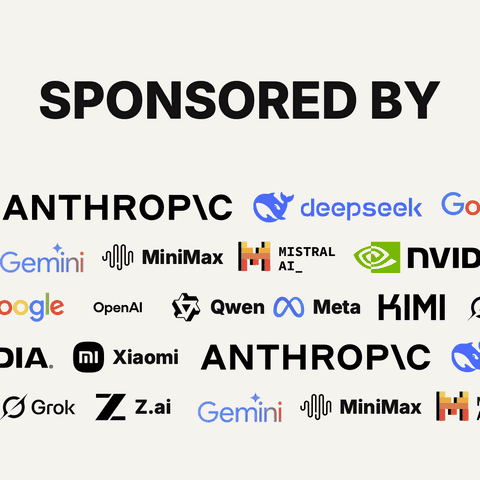

<h1 align="center">sponsored-by</h1>

<p align="center">写一句台词，得到一张「假赞助商滚过屏幕」的卡片。<br>
全程在浏览器里跑 —— 无后端、不上传、不用注册。<br>
<b><a href="https://zyphraxns.github.io/sponsored-by-meme-generator/">在线试用 →</a></b></p>

<p align="center">
  <a href="https://zyphraxns.github.io/sponsored-by-meme-generator/">
    
  </a>
</p>

<p align="center">
  <a href="https://github.com/zyphraxns/sponsored-by-meme-generator/actions/workflows/ci.yml"></a>
  <a href="LICENSE"></a>
  <a href="https://www.typescriptlang.org/"></a>
  <br>
  <sub><a href="#快速开始">快速开始</a> · <a href="#导出格式">导出格式</a> · <a href="#实现结构">实现结构</a> · <a href="README.md">English</a> | <b>简体中文</b></sub>
</p>

> [!WARNING]
> **恶搞作品 —— 与任何品牌无关。** 本项目不暗示任何真实赞助或背书关系，也没有任何品牌为本项目背书。默认内容是 emoji；你也可以从 [simple-icons](https://simpleicons.org) 里挑真实品牌标志插进去——这些标志的商标权归各品牌所有，怎么使用由你负责。如果某个品牌希望移除相关内容，开个 issue 就能处理。

---

## 这是什么

「SPONSORED BY」加上一排 logo 在底下滚动的图，到处都是，但真要做一张，通常得开视频剪辑软件。这个工具只干一件事：在浏览器里把这张卡片精确地渲染出来，并导出成「发到哪儿都能循环播放」的格式。

真正有意思的不是梗本身，而是**预览和四种导出格式共用同一个渲染函数**。卡片长什么样只有一处定义，所以预览看着对，导出就不可能是另一个样子。

## 特性

- **一份渲染器，四种导出** —— `scene(state, t) → SVG` 同时驱动实时预览、PNG、SVG、GIF、MP4。没有独立的「导出渲染器」可以跟预览慢慢走偏。
- **导出器按需加载** —— 首屏只加载编辑器；PNG / GIF / SVG 在点击时取（浏览器空闲时预取），MP4 与 mediabunny 只在按下按钮时加载。当前入口加预载模块约 33 KB（gzip）。
- **无缝循环** —— 滚动数学保证 `t = loop` 时的版面与 `t = 0` 完全一致，循环点不会跳一下。
- **自托管字体、按需取片** —— 拉丁文字用打包内的 Inter 切片；中文用 Noto Sans SC 的 97 个 `unicode-range` 切片，只把屏幕上真正出现的那几个字对应的切片取下来内嵌。导出的 PNG / GIF 在没装这个字体的机器上打开也一模一样。
- **版式即数据** —— 一套版式就是一个 JSON 文件；语气变体是对同一个文件打 RFC 6902 JSON Patch。加版式 = 加一个 JSON，不碰渲染代码。
- **文本层跟着版式走** —— `sponsored-by` 有标题和副标题，`made-by-gang` 有标题和署名行（`@你的朋友`），`no-sponsors` 只有标题。工具栏按模板真实的文本层逐个生成输入框，单文本层的版式不会多出空框；草稿和分享链接按层 id 分别保存文案。
- **平台预设** —— 选「发到哪」，预设会套用该平台推荐的比例、高亮推荐的导出格式，并在**导出前**给出预估体积对比该平台上限。
- **主题与颜色控制** —— 7 套一键主题（象牙、纸白、沙色、墨黑、钴蓝、森林、日落），外加背景 / 前景 / 强调色取色器。强调色画成标题下方的强调线；`单色 logo` 把所有标志统一成前景色。
- **透明静态导出** —— 导出区的 `透明 PNG/SVG` 开关会去掉背景矩形，预览换成棋盘格衬底，导出前就能看出透明效果。GIF / MP4 始终保留不透明背景（这两条链路没有 alpha）；开关会随草稿和分享链接保存。
- **真实品牌字标** —— simple-icons 的 3000+ 单色标志，加上 SVGL 的 153 个官方字标，按背景明暗自动选变体；也可以上传自己的 SVG 或位图。
- **分享链接与一键随机** —— 整套选择压进 URL hash，卡片可以分享或收藏；随机重写版式、配色、图标和文案，一步撤销就能全退回来。
- **撤销 / 重做** —— `Cmd/Ctrl+Z` / `Cmd/Ctrl+Shift+Z`（或 `Ctrl+Y`），工具栏也有对应按钮，最多 50 步。拖滑杆或连续输入文案会合并成一步。
- **任意文本层都是编辑器** —— 点标题、副标题或署名区域就地改字，回车换行，`Cmd/Ctrl+Enter` 或 `Esc` 完成；工具栏每一层都有多行输入框，两种入口都不会丢换行。
- **预览控制** —— 暂停循环、拖时间轴到任意一帧，`导出 PNG` 导出的就是眼前这一帧。
- **刷新不丢作品** —— 当前选择（含上传的 logo，受本地存储上限约束）存在本地。有分享链接时先按链接恢复，但只要真正改过一次，草稿就接管，刷新后看到的仍是改过的版本。
- **分享成品** —— 导出 PNG 后，`分享卡片` 在手机上打开系统分享面板，桌面端复制图片到剪贴板，两者都不可用时退回下载。
- **文件名可找回** —— 导出文件统一叫 `<标题>-<YYYY-MM-DD>-<宽>x<高>.<扩展名>`；选中 GitHub 预设导出 GIF 后，还会给出可直接粘贴的 README `` 片段。
- **图标排序** —— 已选图标可以按住手柄拖动，或用方向键前后移动；图标面板另有「最近使用」一行。
- **界面双语**（English / 简体中文），卡片文案也跟随语言。

## 快速开始

需要 Node.js ≥ 20。

```bash
git clone https://github.com/zyphraxns/sponsored-by-meme-generator.git
cd sponsored-by-meme-generator
npm install
npm run dev          # http://localhost:5173
```

构建静态站（产物用相对路径，可以放到任意静态托管，GitHub Pages 的项目子路径也能直接跑）：

```bash
npm run build        # → dist/
```

## 导出格式

以下数字是默认版式、1:1、4 秒循环，在无头 Chrome 里实测得到的（完整取证链见 [`docs/SPEC.md`](docs/SPEC.md) §9）：

| 格式 | 参数 | 结果 | 说明 |
| --- | --- | --- | --- |
| **GIF** | 1080×1080 · 16 fps · 32 色 · Atkinson 抖动 | 4.0 MB · 67 帧 · 编码约 30 秒 | 真正到处都能循环的格式。调色板采样自全部帧，帧间不闪。导出中途可以取消。 |
| GIF（微信档） | 720×720 · 12 fps | 1.5 MB · 50 帧 | 微信对超过 ~1–2 MB 的动图会静默降级成静态图，所以这一档刻意做小。透明背景会被忽略。 |
| GIF（快速档） | 720×720 · 12 fps | 约 1.5 MB · 编码约 22 秒（预估） | 任何平台都可用的快速选项；导出面板会先显示预估体积与耗时。 |
| **MP4** | 1080×1080 · 30 fps · H.264 | 1.2 MB · 120 帧 | WebCodecs 编码约 2 秒，比 GIF 快一个量级。关键帧间隔等于循环时长，重播接缝不卡。透明背景会被忽略。 |
| **PNG** | 原始尺寸 | ~250 KB | 静态帧，字体以 data URI 内嵌。可选透明背景；开启后按 alpha 判断墨迹范围。 |
| **SVG** | 原始尺寸 | ~5 KB | 矢量，字体走 CDN 引用而非内嵌。可选透明背景。 |

透明背景只支持 PNG 和 SVG；GIF / MP4 始终渲染不透明背景。

## 平台预设

| 预设 | GIF 上限 | 预设做了什么 |
| --- | --- | --- |
| X / 推特 | App 5 MB · 网页 15 MB | 保持 1080p。只有以 GIF 发的帖才无限循环——发 MP4 会变成带进度条的视频帖。 |
| Instagram | — | 套用 4:5，推荐 PNG；信息流不接受动图。Stories / Reels 是 9:16，发这两处要手动切比例。 |
| TikTok | — | 套用 9:16，推荐 MP4（原生上传格式）。 |
| Reddit | 20 MB | 套用 4:5；GIF 内联播放（Reddit 可能自动转成视频）。 |
| GitHub | 10 MB | 保持 1080p。README 里 GIF 自动循环，视频无法内联。 |
| Discord | 20 MB | 保持 1080p。GIF 内联自动播放，MP4 要点击。 |
| 微信 | 2 MB（实用线） | 降到 720×720 / 12 fps。 |
| 小红书 | — | 建议 MP4；GIF 支持不可靠。 |

选中的平台会把对应导出按钮标上「推荐」徽标。体积预估不是拍脑袋，而是拿真实导出结果标定的模型：1 / 3 / 5 / 8 / 12 行五档都实测过，预估值和实测值差几个百分点——所以「超限」提醒在你花 30 秒导出之前就是可信的。

## 快捷键

| 快捷键 | 作用 |
| --- | --- |
| `Cmd/Ctrl+Z` | 撤销上一步编辑 |
| `Cmd/Ctrl+Shift+Z`、`Ctrl+Y` | 重做 |
| `Enter`（卡片上的文本编辑器中） | 手动换行 |
| `Cmd/Ctrl+Enter`、`Esc`（卡片上的文本编辑器中） | 完成编辑 |
| 已选图标 chip 上的方向键 | 把该图标往前 / 往后移 |

焦点在文本框里时不会拦截这些快捷键，保留浏览器自带的文字撤销。

## 实现结构

```
state + t ──► scene() ──► SVG 字符串 ──┬──► innerHTML               （实时预览，60 fps）
                                      ├──► canvas.toBlob()          （PNG）
                                      ├──► modern-gif               （GIF，67 帧）
                                      └──► WebCodecs + mediabunny   （MP4，120 帧）
```

- `src/core/scene.ts` —— 卡片唯一的渲染处。纯函数：同样的输入，同样的字符串。
- `src/core/ticker.ts` —— 无缝滚动数学（周期 = 图标数 × 间距；多行异速用有理数 LCM）。
- `src/core/presets.ts` —— 平台阈值、派生导出参数、标定过的体积预估。
- `src/exporters/` —— 一种格式一个文件，全都只消费 `scene()` 的输出，并且按需加载而不是随首屏打包。
- `src/templates/*.json` —— 版式与其 JSON Patch 变体。

设计决策与取舍理由写在 [`docs/SPEC.md`](docs/SPEC.md)（开写第一行代码之前写的）。

## 浏览器支持

预览、PNG、SVG、GIF 在所有现代浏览器里都能用。**MP4 需要 WebCodecs**（Chrome/Edge 94+、Safari 16.4+、Firefox 桌面 130+；Firefox for Android 不支持）。没有 WebCodecs 时 MP4 按钮会被禁用并说明原因，GIF 依然可用——不会静默产出一个坏文件。

## 文档

- [设计规格与决策台账](docs/SPEC.md) —— 为什么架构长这样
- [贡献指南](CONTRIBUTING.md) —— 开发环境、验证工具、good first issues
- [变更日志](CHANGELOG.md)

## 参与贡献

欢迎提 issue 和 PR。动手之前请先读 [CONTRIBUTING.md](CONTRIBUTING.md)，里面写了这个项目依赖的几个验证脚本怎么用。用中文提 issue / PR 完全没问题。

没有响应时间承诺：这是个人项目，有空才维护。

## 致谢

基于 [modern-gif](https://github.com/niclasvaneyk/modern-gif)（MIT）与 [mediabunny](https://mediabunny.dev)（MPL-2.0）；字体为 [Inter](https://rsms.me/inter/) 与 [Noto Sans SC](https://fonts.google.com/noto/specimen/Noto+Sans+SC)（均为 SIL OFL 1.1，切片来自 [Fontsource](https://fontsource.org)）。

## 许可证

[MIT](LICENSE) © 2026 zyphraxns
